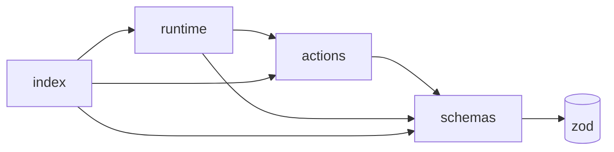
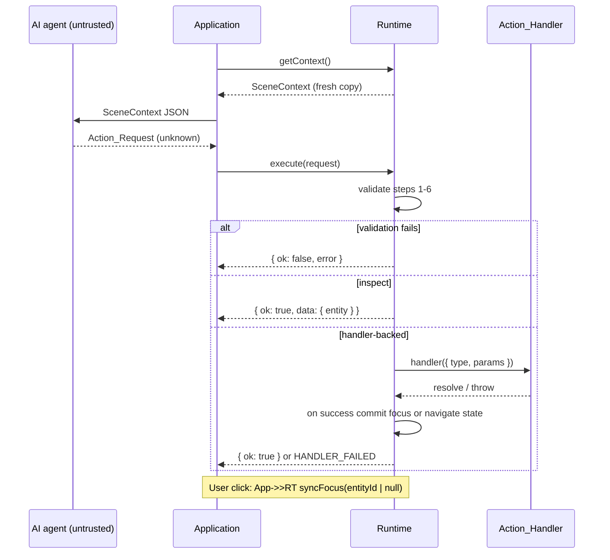

# Design Document: SceneMind Core

## Overview

SceneMind core is a small in-memory TypeScript SDK in `packages/scenemind/`. An application passes a Scene_Graph definition and an initial Scene_ID to `createRuntime`. The Runtime then:

- validates and stores the Scene_Graph (Requirement 1),
- produces a JSON-serializable SceneContext for AI agents (Requirement 3),
- validates untrusted Action_Requests in a fixed order and either calls an application Action_Handler or answers `inspect` itself (Requirements 5, 7, 8),
- tracks the Focused_Entity_ID and accepts validated user-driven focus changes through `syncFocus` (Requirement 10).

The only runtime dependency is `zod` (Requirement 2.1). The package contains no UI, viewer, voice, LLM, storage, network, or authentication code, and no domain names. Domain data lives only in `Entity.metadata` (Requirement 2.3).

Out of scope: generating Parameter_Summary from Zod schemas, reference checks for application-registered actions (Requirements 7.9 and 7.10 cover built-ins only), mutating the Scene_Graph after creation, events, persistence, plugins, and a root monorepo workspace.

### Technical facts the design relies on

- Zod 4 is the current major and needs TypeScript 5.5+ ([Zod 4](https://zod.dev/v4)). The package targets `zod@^4`.
- Zod 4 `z.record` takes a key and a value schema, and `z.json()` accepts any JSON value. Metadata uses `z.record(z.string(), z.json())`.
- Plain `z.object` strips unknown keys; `z.strictObject` rejects them ([Zod 4 changelog](https://zod.dev/v4/changelog)). Parameter schemas use `z.object`, which gives Requirement 7.12.
- fast-check runs inside Vitest through `fc.assert` with `numRuns` ([fast-check docs](https://fast-check.dev/docs/configuration/global-settings/)). It is the only extra dev dependency.

## Architecture

### Package layout

```
packages/scenemind/
  package.json      # "type": "module"; deps: zod; devDeps: typescript, vitest, fast-check
  tsconfig.json     # strict: true
  src/
    index.ts        # single public entry point (Req 9.2)
    schemas.ts      # ID, Entity, Scene, SceneContext, ActionResult, FocusSyncResult schemas and types; SceneMindError
    actions.ts      # SceneAction, defineAction, ActionRegistry, the four built-in actions
    runtime.ts      # createRuntime: graph validation, state, getContext, execute, syncFocus
  test/
    arbitraries.ts  # fast-check generators
    model.ts        # small reference oracle
    *.test.ts
```

Scripts: `build` (`tsc -p tsconfig.build.json`, emits `dist/` from `src/`), `typecheck` (`tsc --noEmit`), `test` (`vitest --run`, Req 9.4).



No module imports anything outside `src/` except `zod` (Requirement 2.5).

### Request flow



### Design decisions

| Decision | Choice | Why |
|---|---|---|
| Error channels | Setup mistakes throw `SceneMindError`; `execute` and `syncFocus` return result values and never throw | Developer errors fail fast. AI and UI input is frequent and untrusted (Req 7.14, 10.12). |
| Stored data | Zod-validate, deep-copy through JSON, deep-freeze | The application cannot mutate stored data later, and JSON round trips hold by construction. |
| Available_Actions | Recomputed on every call, no cache | Satisfies Req 6.5 directly. Action counts are small. |
| Lookups | `Map` for actions, handlers, scenes, entity-to-scene | Names like `__proto__` or `toString` are never found by accident. |
| Handler re-attach | Replaces the previous handler | Lets an application swap handlers without a detach API. |
| Concurrency | No queue. State commits after a handler resolves, with one guard (see State invariants) | Keeps the Runtime simple and avoids deadlocks from handlers that call `execute`. |

## Components and Interfaces

### `schemas.ts`

```ts
export const SceneIdSchema = z.string().min(1);
export const EntityIdSchema = z.string().min(1);

export const EntitySchema = z.object({
  id: EntityIdSchema,
  label: z.string().min(1),
  description: z.string().optional(),
  metadata: z.record(z.string(), z.json()).optional(),
});

export const SceneSchema = z.object({
  id: SceneIdSchema,
  name: z.string().min(1),
  description: z.string().optional(),
  entities: z.array(EntitySchema),
  reachableSceneIds: z.array(SceneIdSchema),
  permittedActions: z.array(z.string().min(1)).optional(),
});

export const SceneGraphDefinitionSchema = z.object({ scenes: z.array(SceneSchema) });

export const ParameterSummarySchema = z.array(
  z.object({ name: z.string(), type: z.string(), description: z.string() }),
);

export const SceneContextSchema = z.object({
  scene: z.object({ id: SceneIdSchema, name: z.string(), description: z.string().optional() }),
  entities: z.array(EntitySchema),
  focusedEntityId: EntityIdSchema.nullable(),
  reachableScenes: z.array(z.object({ id: SceneIdSchema, name: z.string() })),
  actions: z.array(z.object({ type: z.string(), description: z.string(), parameters: ParameterSummarySchema })),
});

export const ErrorCodeSchema = z.enum([
  'INVALID_REQUEST', 'UNKNOWN_ACTION', 'ACTION_UNAVAILABLE', 'INVALID_PARAMETERS',
  'INVALID_SCENE_ID', 'INVALID_ENTITY_ID', 'NO_HANDLER', 'HANDLER_FAILED',
]);

const IssueSchema = z.object({ path: z.string(), message: z.string() });

export const ActionResultSchema = z.discriminatedUnion('ok', [
  z.object({
    ok: z.literal(true),
    type: z.string(),
    params: z.record(z.string(), z.json()),
    data: z.object({ entity: EntitySchema }).optional(),      // inspect only
  }),
  z.object({
    ok: z.literal(false),
    type: z.string().optional(),                              // set once the request shape is valid
    error: z.object({ code: ErrorCodeSchema, message: z.string(), issues: z.array(IssueSchema).optional() }),
  }),
]);

export const FocusSyncRequestSchema = EntityIdSchema.nullable();

export const FocusSyncResultSchema = z.discriminatedUnion('ok', [
  z.object({ ok: z.literal(true), focusedEntityId: EntityIdSchema.nullable() }),
  z.object({
    ok: z.literal(false),
    error: z.object({ code: z.enum(['INVALID_REQUEST', 'INVALID_ENTITY_ID']), message: z.string() }),
  }),
]);

// Inferred types: SceneId, EntityId, Entity, Scene, SceneGraphDefinition, ParameterSummary,
// SceneContext, ErrorCode, ActionResult, FocusSyncResult  (all via z.infer, Req 1.1, 3.7, 8.5, 10.13)

export class SceneMindError extends Error {
  readonly code:
    | 'INVALID_DEFINITION' | 'DUPLICATE_SCENE_ID' | 'DUPLICATE_ENTITY_ID' | 'UNKNOWN_SCENE_ID'
    | 'DUPLICATE_ACTION' | 'UNKNOWN_ACTION' | 'HANDLER_NOT_ALLOWED';
  readonly id?: string;                                              // offending ID or action name
  readonly issues?: readonly { path: string; message: string }[];   // Zod issues for INVALID_DEFINITION
}
```

Entity_IDs are unique across the whole Scene_Graph (Requirement 1.6), so each Entity_ID maps to exactly one Scene.

### `actions.ts`

```ts
export interface SceneAction<T extends string = string, S extends z.ZodObject = z.ZodObject> {
  readonly type: T;
  readonly description: string;
  readonly params: S;
  readonly parameterSummary: ParameterSummary;
}

export type ActionHandler<T extends string = string, P = unknown> =
  (action: { type: T; params: P }) => void | Promise<void>;

export function defineAction<T extends string, S extends z.ZodObject>(
  def: { type: T; description: string; params: S; parameterSummary: ParameterSummary },
): SceneAction<T, S>;

export class ActionRegistry {
  register(action: SceneAction): void;   // throws DUPLICATE_ACTION (Req 4.1, 4.2)
  get(type: string): SceneAction | undefined;
  entries(): readonly SceneAction[];     // registration order
  list(): { type: string; description: string; parameters: ParameterSummary }[];  // registration order, copies (Req 4.7)
}

export const focusAction, highlightAction, inspectAction;  // params: z.object({ entityId: EntityIdSchema })
export const navigateAction;                               // params: z.object({ sceneId: SceneIdSchema })
```

`defineAction` validates `type` (non-empty) and `parameterSummary`, copies the summary, and returns a frozen object, so later edits by the author do not reach the SceneContext (Requirement 3.6). Built-in descriptions are generic. Handler parameter types come from `z.output<S>` (Requirement 4.3). Handler return values are ignored; a handler fails only by throwing or rejecting.

### `runtime.ts`

```ts
export function createRuntime<const A extends readonly SceneAction[] = readonly []>(config: {
  scenes: SceneGraphDefinition;
  initialSceneId: SceneId;
  actions?: A;                 // registered after the four built-ins (Req 5.5)
}): Runtime<A>;

export interface Runtime<A extends readonly SceneAction[]> {
  getCurrentSceneId(): SceneId;
  getFocusedEntityId(): EntityId | null;
  getContext(): SceneContext;
  getAvailableActions(): string[];
  listActions(): ReturnType<ActionRegistry['list']>;
  attachHandler<K extends HandlerBackedName<A>>(type: K, handler: ActionHandler<K, ParamsOf<A, K>>): void;
  execute(request: unknown): Promise<ActionResult>;
  syncFocus(input: unknown): FocusSyncResult;
}
```

`HandlerBackedName<A>` is every built-in and custom name except `inspect`; `ParamsOf<A, K>` is `z.output` of that action's schema. Every exported function has explicit parameter and return types (Requirement 9.3).

`createRuntime` steps, throwing `SceneMindError` on the first problem:

1. Parse the definition and initial Scene_ID with Zod, else `INVALID_DEFINITION` with issues (Req 1.4).
2. First repeated Scene_ID → `DUPLICATE_SCENE_ID`; first repeated Entity_ID anywhere → `DUPLICATE_ENTITY_ID` (Req 1.5, 1.6).
3. First undefined reachable Scene_ID, then an undefined initial Scene_ID → `UNKNOWN_SCENE_ID` (Req 1.7, 1.8).
4. Copy, freeze, index. Set Current_Scene to the initial Scene and Focused_Entity_ID to `null` (Req 1.9, 10.1).
5. Register built-ins, then `config.actions`; a reused name → `DUPLICATE_ACTION`.

A `permittedActions` entry naming an unregistered action is allowed and ignored (Requirement 6.2).

`attachHandler` checks at runtime too, because JavaScript callers can bypass types: `inspect` → `HANDLER_NOT_ALLOWED` (Req 4.6); unregistered name → `UNKNOWN_ACTION` (Req 4.5); non-function → `INVALID_DEFINITION`. Otherwise the handler is stored in a `Map` (Req 4.4). A failed call changes nothing.

`getContext()` builds new objects on every call (Req 3.9): the Current_Scene's ID, name, and description; its Entities in definition order with all fields; `focusedEntityId`; reachable Scenes as `{ id, name }` in listed order; and one entry per Available_Action in registration order with the Parameter_Summary as supplied (Req 3.1–3.6, 3.10). Absent optional fields are omitted, never set to `undefined`.

## Data Models

### Scene_Graph definition

```json
{
  "scenes": [
    { "id": "room-a", "name": "Room A", "entities": [{ "id": "box-1", "label": "Box", "metadata": { "color": "red" } }],
      "reachableSceneIds": ["room-b"] },
    { "id": "room-b", "name": "Room B", "entities": [{ "id": "lamp-1", "label": "Lamp" }],
      "reachableSceneIds": ["room-a"], "permittedActions": ["inspect", "navigate"] }
  ]
}
```

`room-a` has no `permittedActions`, so every registered action is permitted there.

### SceneContext

```json
{
  "scene": { "id": "room-a", "name": "Room A" },
  "entities": [{ "id": "box-1", "label": "Box", "metadata": { "color": "red" } }],
  "focusedEntityId": null,
  "reachableScenes": [{ "id": "room-b", "name": "Room B" }],
  "actions": [
    { "type": "focus", "description": "Bring an entity in the current scene into focus.",
      "parameters": [{ "name": "entityId", "type": "string", "description": "ID of an entity in the current scene." }] }
  ]
}
```

### Action_Request (untrusted, typed `unknown`)

```json
{ "type": "focus", "params": { "entityId": "box-1" } }
```

### Action_Result

```json
{ "ok": true, "type": "focus", "params": { "entityId": "box-1" } }
{ "ok": true, "type": "inspect", "params": { "entityId": "box-1" }, "data": { "entity": { "id": "box-1", "label": "Box", "metadata": { "color": "red" } } } }
{ "ok": false, "type": "focus", "error": { "code": "INVALID_PARAMETERS", "message": "Parameters do not match the action schema.", "issues": [{ "path": "entityId", "message": "Invalid input: expected string, received number" }] } }
```

### Focus_Sync_Result

```json
{ "ok": true, "focusedEntityId": "box-1" }
{ "ok": false, "error": { "code": "INVALID_ENTITY_ID", "message": "Entity is not in the current scene." } }
```

### Runtime state

| Field | Changes when |
|---|---|
| Scene_Graph, registry | Never after `createRuntime` |
| handlers (`Map`) | `attachHandler` |
| `currentSceneId` | A `navigate` handler resolves |
| `focusedEntityId` | A `focus` handler resolves, a `navigate` handler resolves (→ `null`), or `syncFocus` succeeds |

## Validation

### Available_Actions rule (Requirement 6)

```ts
registry.entries()   // registration order
  .filter(a => current.permittedActions === undefined || current.permittedActions.includes(a.type))
  .filter(a => a.type === 'inspect' || handlers.has(a.type));
```

Read from live state on every `getContext()`, `getAvailableActions()`, and `execute()` call.

### `execute` pipeline (Requirement 7)

The whole body runs inside `try/catch`. The first failed step returns its code. No handler runs and no state changes before step 6 passes (Req 7.2, 7.11).

| Step | Check | Code |
|---|---|---|
| 1 | `request` is a non-null, non-array object; `type` is a string; the `params` key exists. `type` and `params` are read once inside `try`, so throwing getters or Proxy traps fail here. | `INVALID_REQUEST` |
| 2 | `type` is registered (`Map` lookup) | `UNKNOWN_ACTION` |
| 3 | `type` is a Permitted_Action of the Current_Scene | `ACTION_UNAVAILABLE` |
| 4 | Handler attached (skipped for `inspect`) | `NO_HANDLER` |
| 5 | `action.params.safeParse(params)` inside `try`, then JSON-copy the output. Zod issues become `{ path, message }`; a throw or a non-JSON output (e.g. bigint from a custom schema) also fails. | `INVALID_PARAMETERS` |
| 6 | Built-ins only. `navigate`: `sceneId` is defined and in the Current_Scene's `reachableSceneIds`. `focus`, `highlight`, `inspect`: `entityId` belongs to the Current_Scene. | `INVALID_SCENE_ID` / `INVALID_ENTITY_ID` |

After validation:

- `inspect`: return `{ ok: true, type, params, data: { entity } }` with a copy of the Entity. No handler, no state change (Req 5.11, 5.12, 8.3).
- Handler-backed: `await handler({ type, params: parsed })` once inside `try` (Req 8.1, 7.12).
  - Resolves: commit state (below) and return `{ ok: true, type, params }` (Req 8.2).
  - Throws or rejects: change nothing and return `HANDLER_FAILED` with `Handler failed: <message>` when the thrown value is an `Error` with a readable string message, else `Handler failed.` (Req 5.10, 8.4, 10.3).

Request data is only read as plain data, matched against `Map` keys, and parsed by Zod. It never reaches `eval`, `Function`, dynamic imports, or property lookups on application objects (Req 7.13). Failure messages are fixed templates and do not echo `params`. The outer `catch` returns `INVALID_REQUEST` as a safety net so the Promise never rejects (Req 7.14).

### `syncFocus` (Requirement 10)

Synchronous, wrapped in `try/catch`, returns a Focus_Sync_Result and never throws (Req 10.12):

1. `FocusSyncRequestSchema.safeParse(input)`. Failure (anything other than a non-empty string or `null`) → `INVALID_REQUEST` (Req 10.5, 10.8).
2. `null` → set Focused_Entity_ID to `null`, return `{ ok: true, focusedEntityId: null }` (Req 10.6).
3. String whose Entity belongs to the Current_Scene → set it and return success (Req 10.7). Otherwise → `INVALID_ENTITY_ID` (Req 10.9).

It ignores `permittedActions` and Available_Actions, calls no handler, and never changes the Scene_Graph or Current_Scene (Req 10.10, 10.11). A failure leaves Focused_Entity_ID unchanged.

## State Invariants

1. Current_Scene always names a defined Scene.
2. Focused_Entity_ID is `null` or an Entity of the Current_Scene (Req 10.2).
3. A failed `execute` (any code) or failed `syncFocus` changes no state (Req 7.11, 10.3, 10.8, 10.9).
4. `navigate`: after its handler resolves, Current_Scene becomes `sceneId` and Focused_Entity_ID becomes `null` in the same synchronous step (Req 5.8, 5.9, 5.14). Inside the handler, the old state is still visible.
5. `focus`: after its handler resolves, Focused_Entity_ID becomes `entityId` (Req 5.13), guarded by a check that the Entity still belongs to the Current_Scene. The guard matters only when the application runs `execute` calls concurrently and a `navigate` finishes while the `focus` handler is pending. In that case the focus is dropped, the result is still `ok: true`, and invariant 2 holds. Applications that await each `execute` never hit this case.
6. `highlight` and `inspect` never change state (Req 10.4, 5.12).
7. `getContext()` returns a fresh copy; mutating it changes nothing (Req 3.9).

## Usage Example

```ts
import { createRuntime } from 'scenemind';

const runtime = createRuntime({
  initialSceneId: 'room-a',
  scenes: {
    scenes: [
      { id: 'room-a', name: 'Room A', entities: [{ id: 'box-1', label: 'Box' }], reachableSceneIds: ['room-b'] },
      { id: 'room-b', name: 'Room B', entities: [{ id: 'lamp-1', label: 'Lamp' }], reachableSceneIds: ['room-a'] },
    ],
  },
});

runtime.attachHandler('focus', async ({ params }) => viewer.lookAt(params.entityId));   // params: { entityId: string }
runtime.attachHandler('navigate', async ({ params }) => viewer.loadScene(params.sceneId));

// Give the AI agent the current context.
const reply = await agent.ask(JSON.stringify(runtime.getContext()));

// Execute the agent's untrusted request.
const result = await runtime.execute(JSON.parse(reply.actionJson));
if (result.ok) {
  showStatus(`Done: ${result.type}`);
} else {
  agent.tell(`Action failed: ${result.error.code} ${result.error.message}`);
}

// The user clicked an entity in the viewer.
viewer.onEntityClick(id => {
  const sync = runtime.syncFocus(id);
  if (!sync.ok) console.warn(sync.error.code);
});
```

`viewer`, `agent`, and `showStatus` stand for application code; SceneMind does not provide them.

## Correctness Properties

*A property is a characteristic or behavior that should hold true across all valid executions of a system-essentially, a formal statement about what the system should do. Properties serve as the bridge between human-readable specifications and machine-verifiable correctness guarantees.*

Several properties compare the Runtime with a reference model in `test/model.ts`. The model holds the definition, current Scene_ID, Focused_Entity_ID, registered actions, and attached handler names, and implements two functions written from the Glossary and Requirement 7.3: `expectedAvailable(model)` and `expectedOutcome(model, request)` (an Error_Code or `'OK'`). It does not import `src/runtime.ts`.

"Operation sequence" below means a random interleaving of `attachHandler`, awaited `execute` calls (valid and invalid), and `syncFocus` calls, with spy handlers that randomly succeed or fail.

### Property 1: Definition validation

*For any* valid Scene_Graph definition and initial Scene_ID in it, `createRuntime` succeeds with `getCurrentSceneId()` equal to the initial ID and `getFocusedEntityId()` equal to `null`. *For any* single mutation of a valid definition (duplicate Scene_ID, duplicate Entity_ID, undefined reachable Scene_ID, undefined initial Scene_ID, schema-invalid field), `createRuntime` throws `SceneMindError` with the matching code and, except for schema failures, `id` equal to the offending ID.

**Validates: Requirements 1.4, 1.5, 1.6, 1.7, 1.8, 1.9, 10.1**

### Property 2: SceneContext matches the model

*For any* definition, custom actions, and operation sequence, after each step `getContext()` has `scene`, `entities`, `focusedEntityId`, and `reachableScenes` equal to the model's current state, and its `actions` (and `getAvailableActions()`) equal `expectedAvailable(model)` in registration order, with descriptions and Parameter_Summaries deep-equal to the defined values.

**Validates: Requirements 3.1, 3.2, 3.3, 3.4, 3.5, 3.6, 3.10, 6.1, 6.2, 6.3, 6.4, 6.5**

### Property 3: SceneContext is a JSON-safe copy

*For any* Runtime state reached by an operation sequence, `SceneContextSchema.parse(JSON.parse(JSON.stringify(ctx)))` deep-equals `ctx`, and *for any* random deep mutation of `ctx`, the next `getContext()` deep-equals a snapshot taken before the mutation and the current Scene and focus are unchanged.

**Validates: Requirements 3.8, 3.9**

### Property 4: Registry names are unique and checked

*For any* list of action definitions with possibly repeated names, registering them in order throws `DUPLICATE_ACTION` exactly for repeated names, and `list()` equals the first definition of each name in registration order. *For any* string that is not registered (including `__proto__`, `toString`, `constructor`), `attachHandler` throws `UNKNOWN_ACTION` with that `id` and Available_Actions are unchanged.

**Validates: Requirements 4.1, 4.2, 4.5, 4.7**

### Property 5: Validation order matches the oracle

*For any* Runtime state and *for any* request from a generator biased to reach every pipeline step, `execute(request)` returns `ok: true` exactly when `expectedOutcome` is `'OK'`, and otherwise `error.code` equals `expectedOutcome`. `INVALID_PARAMETERS` failures have non-empty `issues`.

**Validates: Requirements 7.3, 7.4, 7.5, 7.6, 7.7, 7.8, 7.9, 7.10**

### Property 6: Failed requests have no side effects

*For any* Runtime state and *for any* request that fails with a code other than `HANDLER_FAILED`, no spy handler is called and the current Scene, Focused_Entity_ID, and `getContext()` are unchanged.

**Validates: Requirements 7.2, 7.11**

### Property 7: `execute` is total and its results round-trip

*For any* value (from `fc.anything()`, plus objects with throwing getters, Proxies with throwing traps, and params with throwing nested getters), `execute` resolves and never rejects, and the result `r` satisfies `ActionResultSchema.parse(JSON.parse(JSON.stringify(r)))` deep-equal to `r`.

**Validates: Requirements 7.1, 7.13, 7.14, 8.5, 8.6**

### Property 8: Valid handler-backed requests call the handler once with parsed params

*For any* request that passes validation for a handler-backed action (built-in or custom), with random extra keys in `params`, the attached handler is called exactly once with `{ type, params: schema.parse(params) }` (extra keys absent), and a successful handler yields `{ ok: true, type, params }` with the same parsed params.

**Validates: Requirements 4.4, 5.6, 5.7, 7.12, 8.1, 8.2**

### Property 9: Handler outcome decides state changes

*For any* valid `focus`, `highlight`, or `navigate` request and *for any* handler outcome (return, resolve, throw Error, throw non-Error, reject, throw an object whose `message` getter throws), the state seen inside the handler equals the state before the request. On success: `navigate` sets Current_Scene to `sceneId` and Focused_Entity_ID to `null`; `focus` sets Focused_Entity_ID to `entityId`; `highlight` changes nothing. On failure: the result code is `HANDLER_FAILED` and Current_Scene and Focused_Entity_ID are unchanged.

**Validates: Requirements 5.8, 5.9, 5.10, 5.13, 5.14, 8.4, 10.3, 10.4**

### Property 10: `inspect` answers without handlers or state changes

*For any* Runtime state where `inspect` is permitted and *for any* Entity of the Current_Scene, `execute({ type: 'inspect', params: { entityId } })` returns `ok: true` with `data.entity` deep-equal to the defined Entity, no spy is called, and Current_Scene, Focused_Entity_ID, and `getContext()` are unchanged.

**Validates: Requirements 5.11, 5.12, 8.3, 10.4**

### Property 11: `syncFocus` follows its rule

*For any* Runtime state (including Scenes whose `permittedActions` exclude `focus`) and *for any* input (from `fc.anything()`, `null`, Entity_IDs from the current and other Scenes, unknown strings, `""`, hostile objects), `syncFocus` returns without throwing a value accepted by `FocusSyncResultSchema`, and:
- `null` → success with `focusedEntityId: null`, and focus becomes `null`;
- an Entity_ID of the Current_Scene → success with that ID, and focus becomes that ID;
- any other string → `INVALID_ENTITY_ID`; any non-string-non-null or `""` → `INVALID_REQUEST`; in both cases focus is unchanged.

In every case no spy is called and Current_Scene and the Scene_Graph are unchanged.

**Validates: Requirements 10.5, 10.6, 10.7, 10.8, 10.9, 10.10, 10.11, 10.12, 10.13**

### Property 12: Focus invariant holds under any interleaving

*For any* definition and *for any* operation sequence, including non-awaited concurrent `execute` calls whose handlers resolve in random order and `syncFocus` calls made while handlers are pending, `getFocusedEntityId()` is always `null` or the ID of an Entity in the Scene named by `getCurrentSceneId()`, and that Scene always exists.

**Validates: Requirements 10.2**

## Error Handling

Two channels with no overlap:

- **`SceneMindError` (thrown)**: only from `createRuntime`, `defineAction`, `ActionRegistry.register`, and `attachHandler`, for setup mistakes. Codes: `INVALID_DEFINITION` (with Zod `issues`), `DUPLICATE_SCENE_ID`, `DUPLICATE_ENTITY_ID`, `UNKNOWN_SCENE_ID`, `DUPLICATE_ACTION`, `UNKNOWN_ACTION`, `HANDLER_NOT_ALLOWED`. `id` holds the offending ID or name. A failed call changes nothing.
- **Result values (returned)**: `execute` returns an Action_Result with one of the eight Error_Codes (see Validation); `syncFocus` returns a Focus_Sync_Result with `INVALID_REQUEST` or `INVALID_ENTITY_ID`. Neither throws or rejects.

Untrusted input is read once inside `try`; later steps use the captured values. Messages are fixed templates without stack traces or echoed params, because they go back to an AI agent.

## Testing Strategy

- **Vitest** with `vitest --run` from `packages/scenemind/` (Req 9.4). `tsc --noEmit` covers `expectTypeOf` and `@ts-expect-error` type tests.
- **fast-check** (dev dependency) implements each of Properties 1–12 as a single property test with at least `{ numRuns: 100 }`, tagged:
  `// Feature: scenemind-core, Property 5: Validation order matches the oracle`
- **Generators** (`test/arbitraries.ts`): valid graphs (1–6 Scenes, 0–5 Entities, small ID alphabets, `fc.jsonValue()` metadata, absent/empty/mixed `permittedActions`), 0–3 custom actions, near-valid requests, hostile values, and operation sequences.

Example tests, one per behavior:

- One request per Error_Code (Req 9.5), including a direct `NO_HANDLER` test: default Runtime, no handlers, `execute({ type: 'focus', params: { entityId: <valid> } })` (Req 9.6).
- Each `syncFocus` case: `null`, valid ID, ID from another Scene, `""`, a number (Req 10.14).
- Built-in schemas accept the required field, reject `{}`, strip extras (Req 5.1–5.4); a default Runtime lists the four built-ins (Req 5.5); `attachHandler('inspect', …)` throws `HANDLER_NOT_ALLOWED` (Req 4.6).
- Metadata rejects a function and a bigint (Req 1.2); Scenes parse with and without optional fields (Req 1.3).
- Code-like request strings (e.g. `"globalThis.pwned = true"`) have no effect (Req 7.13).
- Type tests: inferred `Entity`/`Scene` (Req 1.1), `execute(unknown)` (Req 7.1), custom handler param types (Req 4.3).
- Package checks: `dependencies` is exactly `zod` (Req 2.1); `exports` has only `"."` (Req 9.2); `strict: true` (Req 9.1); `src/` has no `eval(`, `new Function`, or imports outside `src/` and `zod` (Req 2.5, 7.13); exported names match a snapshot of generic names (Req 2.2).

Not automatically tested: Requirement 2.4 (covered by the dependency check and review) and Requirement 9.3 (review plus type tests).
